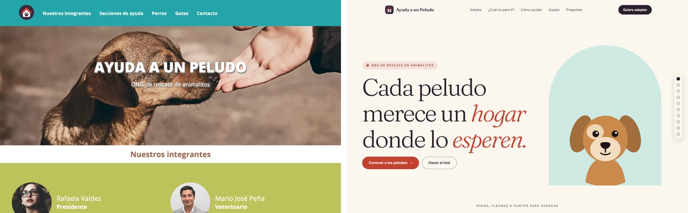
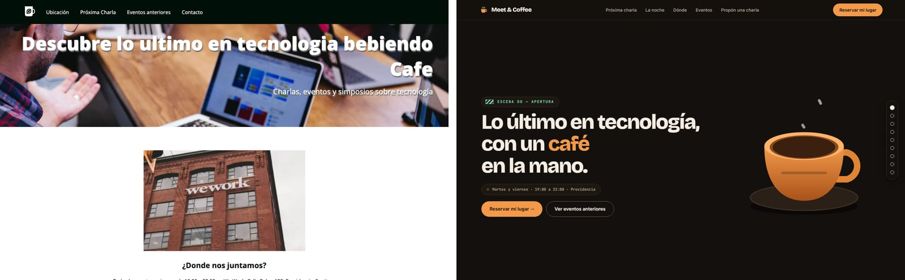

<div align="center">

# Landing remakes

**Dos landings que hice como estudiante, reconstruidas y mejoradas con un stack moderno.**

[](https://github.com/mauricloudz/landing-remakes/actions/workflows/deploy.yml)


### [Ver la galería con el antes y después →](https://mauricloudz.github.io/landing-remakes/)

</div>

---

## Ayuda a un Peludo · original de 2024

ONG ficticia de adopción de perros y gatos.



**Nuevo:** diez escenas a pantalla completa en vez de scroll, con elementos ancla que viajan entre ellas (View Transitions), textos que entran por máscaras, galería ficha por ficha con filtro de perros y gatos, test "¿Qué peludo es para ti?", pasos de la adopción, preguntas frecuentes con respuesta en panel fijo y formulario con validación.

[Ver el sitio](https://mauricloudz.github.io/landing-remakes/ayuda-a-un-peludo/)

## Meet & Coffee · original de 2021

Comunidad ficticia de charlas de tecnología.



**Nuevo:** nueve escenas a pantalla completa en vez de scroll, con una portada que se zambulle en la taza hasta la cuenta regresiva real (hora de Santiago), afiche de la próxima charla con entrada tipo ticket, agenda de la noche hora por hora con su programa, mapa con la dirección, eventos anteriores tarjeta por tarjeta con página de detalle y formulario para proponer charlas, con preguntas frecuentes en panel fijo en escritorio.

[Ver el sitio](https://mauricloudz.github.io/landing-remakes/meet-and-coffee/)

---

## Métricas

Medidas con Lighthouse en su perfil móvil (las versiones originales con la 13.5 y las nuevas con la 13.6), sirviendo ambas en local en las mismas condiciones.

| | Peludo antes | Peludo después | Meet antes | Meet después |
|---|---|---|---|---|
| Rendimiento | 69 | **100** | 67 | **100** |
| Accesibilidad | 78 | **100** | 89 | **100** |
| Buenas prácticas | 96 | **100** | 96 | **100** |
| SEO | 91 | **100** | 100 | **100** |
| Carga del contenido principal | 6,8 s | **0,9 s** | 16,2 s | **0,9 s** |
| Peso de la página | 1.025 KB | **163 KB** | 2.798 KB | **172 KB** |
| Ancho en un teléfono de 390 px | 481 px | **390 px** | 519 px | **390 px** |

Los originales se desbordaban a lo ancho en el teléfono. Las versiones nuevas no.

## Decisiones

- **Ilustraciones propias en vez de fotos de stock.** Todo es SVG hecho a medida: pesa casi nada y se puede animar.
- **Movimiento en CSS, sin librerías.** Ayuda a un Peludo (diez escenas) y Meet & Coffee (nueve) pasan entre sus escenas a pantalla completa con la API de View Transitions. La galería (siete escenas) usa el mismo modelo: el marco del comparador se divide en dos teléfonos y vuelve a fundirse en el siguiente proyecto. Si el navegador no la soporta o el sistema pide movimiento reducido, la página se ve como una página normal.
- **Poco JavaScript.** Astro entrega HTML estático. El JavaScript se limita al enrutador de Astro para las transiciones, el filtro, el test, la cuenta regresiva, el comparador, los formularios y un controlador de escenas pequeño en cada una de las tres páginas.
- **Transiciones entre páginas** con la API de View Transitions.
- **SEO completo:** metadatos, Open Graph, datos estructurados de schema.org, sitemap y URLs canónicas.

## Desarrollo local

```bash
npm install
npm run dev
```

El sitio queda en `http://localhost:4321/landing-remakes/`. Se publica en GitHub Pages con cada push a `main`.

---

<sub>Las ONG, comunidades, personas y eventos son ficticios. Los formularios son demostrativos y no envían datos.</sub>

<sub>Hecho por [Mauricio Poblete](https://github.com/mauricloudz).</sub>
