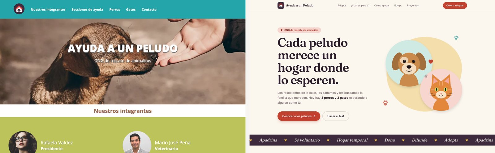
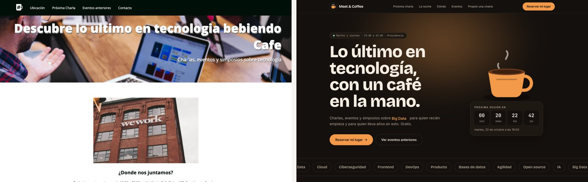

<div align="center">

# Landing remakes

**Dos landings que hice como estudiante, reconstruidas y mejoradas con un stack moderno.**

[](https://github.com/mauricloudz/landing-remakes/actions/workflows/deploy.yml)


### [Ver la galería con el antes y después →](https://mauricloudz.github.io/landing-remakes/)

</div>

---

## Ayuda a un Peludo · original de 2024

ONG ficticia de adopción de perros y gatos.



**Nuevo:** retratos ilustrados en SVG con animaciones, filtro de perros y gatos con transición, test "¿Qué peludo es para ti?", proceso de adopción que avanza al hacer scroll, preguntas frecuentes y formulario con validación.

[Ver el sitio](https://mauricloudz.github.io/landing-remakes/ayuda-a-un-peludo/)

## Meet & Coffee · original de 2021

Comunidad ficticia de charlas de tecnología.



**Nuevo:** cuenta regresiva real a la próxima sesión en hora de Santiago, taza con vapor animado, carrusel de eventos con transición hacia cada detalle, una página por evento con contenido real, agenda de la noche y formulario para proponer charlas.

[Ver el sitio](https://mauricloudz.github.io/landing-remakes/meet-and-coffee/)

---

## Métricas

Medidas con Lighthouse 13.5 en su perfil móvil, sirviendo ambas versiones en local en las mismas condiciones.

| | Peludo antes | Peludo después | Meet antes | Meet después |
|---|---|---|---|---|
| Rendimiento | 69 | **100** | 67 | **98** |
| Accesibilidad | 78 | **100** | 89 | **100** |
| Buenas prácticas | 96 | **100** | 96 | **100** |
| SEO | 91 | **100** | 100 | **100** |
| Carga del contenido principal | 6,8 s | **1,5 s** | 16,2 s | **2,0 s** |
| Peso de la página | 1.025 KB | **111 KB** | 2.798 KB | **157 KB** |
| Ancho en un teléfono de 390 px | 481 px | **390 px** | 519 px | **390 px** |

Los originales se desbordaban a lo ancho en el teléfono. Las versiones nuevas no.

## Decisiones

- **Ilustraciones propias en vez de fotos de stock.** Todo es SVG hecho a medida: pesa casi nada y se puede animar.
- **Animaciones que respetan el movimiento reducido.** Si el sistema lo pide, todo queda quieto. La barra de progreso y el parallax usan animaciones ligadas al scroll, sin JavaScript.
- **Casi cero JavaScript.** Astro entrega HTML estático. El JavaScript se limita al filtro, el test, la cuenta regresiva, el comparador y los formularios.
- **Transiciones entre páginas** con la API de View Transitions.
- **SEO completo:** metadatos, Open Graph, datos estructurados de schema.org, sitemap y URLs canónicas.

## Desarrollo local

```bash
npm install
npm run dev
```

El sitio queda en `http://localhost:4321/landing-remakes/`. Se publica en GitHub Pages con cada push a `main`.

---

<sub>Las ONG, comunidades, personas y eventos son ficticios. Los formularios son demostrativos y no envían datos.</sub>

<sub>Hecho por [Mauricio Poblete](https://github.com/mauricloudz).</sub>
